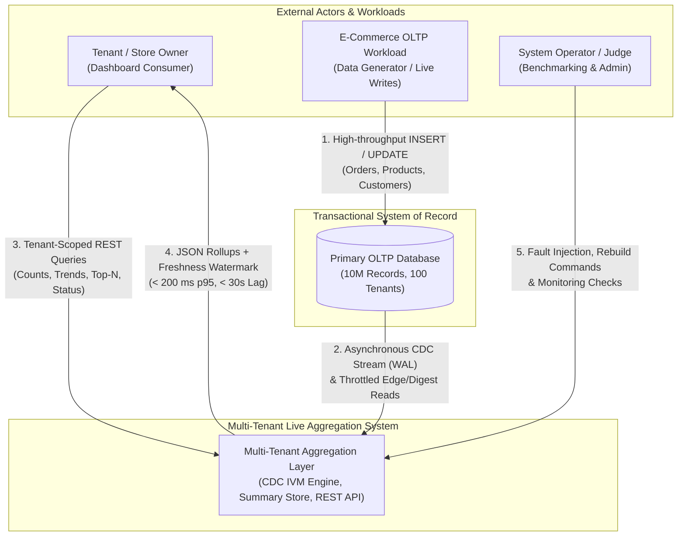
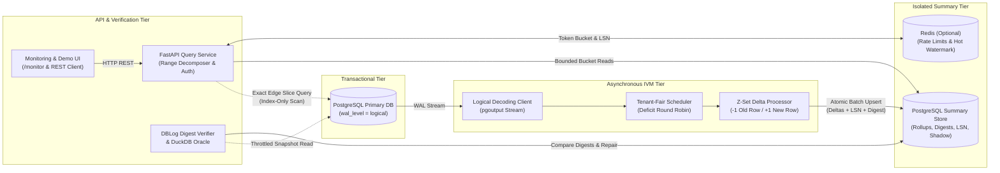
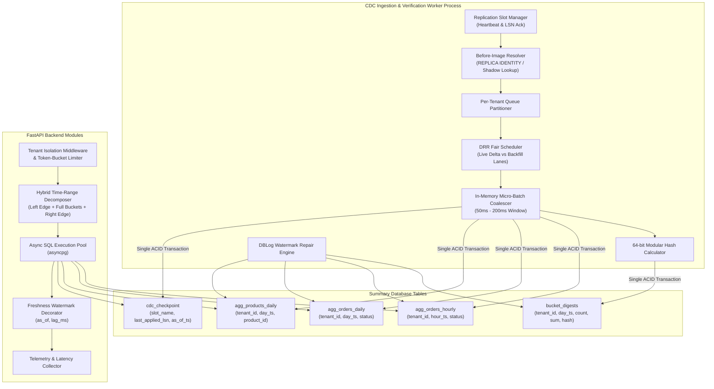
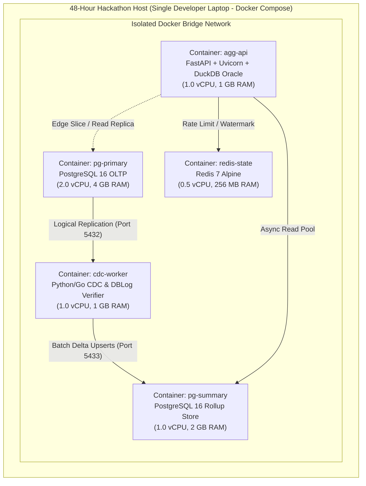

This System Architecture and Technical Design Document defines the complete implementation blueprint for the **Multi-Tenant Live Aggregation Layer**, translating the approved Software Requirements Specification (SRS), the organizer's Problem Requirements Document (PRD), and the Incremental View Maintenance (IVM) research findings into a buildable 48-hour hackathon system.

## 1. Architecture Overview

### 1.1 Architecture Goals

The architecture is engineered to satisfy the six primary goals and stretch performance targets established in the PRD on a single developer laptop hosting 10 million records across 100 skewed tenants:

* **Sub-200 ms Query Speed:** Serve all four mandatory tenant dashboard queries (counts/totals, temporal trends, Top-N products, and category breakdowns) in under 200 ms at the 95th percentile.


* **Sub-30 Second Data Freshness:** Propagate newly inserted orders and status modifications from the primary transactional database to queryable summary tables within 30 seconds (targeting 1 to 5 seconds in normal operation).


* **Under 10% Primary Database Overhead:** Isolate analytical read workloads and rollup maintenance from the transactional write path so normal application reads and writes slow down by less than 10%.


* **100% Mathematical Exactness:** Match direct ground-truth SQL queries across all endpoints, including queries with non-aligned time boundaries and order cancellations.


* **Strict Multi-Tenant Isolation & Fairness:** Guarantee zero cross-tenant data leakage while preventing large "whale" tenants from starving smaller tenants during ingestion bursts or backfills.


* **Sub-Linear Scaling Growth:** Ensure query latency grows by less than 2x when scaling the dataset 10x from 1 million rows (10 tenants) to 10 million rows (100 tenants).


### 1.2 Design Principles

* **Write-Path Decoupling:** Never attach synchronous triggers or exclusive view locks to the primary OLTP database; capture changes asynchronously from the replication log.


* **Z-Set Retraction Algebra:** Model every database mutation as an algebraic multiset delta where inserts carry weight +1, deletes carry weight -1, and updates emit a retraction of the old row (-1) followed by an insertion of the new row (+1).


* **Bucket-Bounded Query Complexity:** Pre-aggregate metrics into fixed temporal grains (hour and day buckets) so query cost scales with the time window requested ($O(\text{buckets})$) rather than the tenant's raw order volume ($O(\text{rows})$).


* **Atomic Offset-Delta Commit:** Persist the replication Log Sequence Number (LSN) inside the same database transaction as the summary table updates to guarantee idempotent, exactly-once state transitions without distributed two-phase commit overhead.


* **Verifiable Anti-Entropy:** Treat correctness as an observable runtime contract by maintaining incremental per-bucket hash digests and repairing drift via lock-free watermark-bracketed chunking.


### 1.3 Architectural Style

The system implements an **Event-Driven Command Query Responsibility Segregation (CQRS)** architecture powered by **Asynchronous Incremental View Maintenance (IVM)** over Change Data Capture (CDC). Rather than introducing heavyweight distributed streaming clusters, it uses a lean, modular monolith worker pattern deployed as resource-constrained containers.

### 1.4 High-Level Component Overview

1. **Primary OLTP Database (PostgreSQL Primary):** Hosts the base transactional tables (orders, order items, products, customers) and emits logical write-ahead log (WAL) events.


2. **CDC Ingestion & Retraction Engine (Python/Go Worker):** Consumes the replication stream, resolves before-images, schedules tenant work via Deficit Round Robin (DRR), and computes Z-set deltas.


3. **Isolated Summary Store (PostgreSQL Summary Instance):** Stores pre-aggregated hourly/daily rollups, compact order shadow state, bucket digests, and the transactional LSN checkpoint.


4. **Hybrid Query & Admission API (FastAPI Service):** Enforces tenant isolation and per-tenant rate limits, decomposes arbitrary time ranges into full interior buckets plus exact edge slices, and decorates responses with freshness watermarks.


5. **Verification & Targeted Repair Service (DuckDB + DBLog Reconciler):** Periodically validates bucket digests against throttled source snapshots and repairs mismatched buckets without blocking live traffic.


6. **Monitoring & Demo UI:** A lightweight web interface displaying live query latencies, replication lag, and verification health.


## 2. Architecture Diagrams

### 2.1 System Context Diagram

The System Context Diagram illustrates the external actors and systems interacting with the Multi-Tenant Live Aggregation Layer.



### 2.2 High-Level Architecture Diagram

The High-Level Architecture Diagram shows the end-to-end separation between the transactional write path, the asynchronous rollup maintenance pipeline, and the low-latency analytical read path.



### 2.3 Component Architecture Diagram

The Component Architecture Diagram details the internal modules inside the Ingestion Worker, Summary Store, and API Backend.



### 2.4 Data Flow Diagram

The sequence diagram below traces three critical runtime flows: (1) Live Order Status Update & Retraction, (2) Hybrid Arbitrary-Range Dashboard Query, and (3) Targeted Anti-Entropy Bucket Repair.

```mermaid
sequenceDiagram
    autonumber
    actor App as OLTP App / Generator
    participant Primary as Primary DB (OLTP)
    participant CDC as CDC Engine (DRR + Z-Set)
    participant Summary as Summary Store DB
    participant API as FastAPI Backend
    actor Client as Tenant Dashboard

    rect rgb(235, 245, 255)
    Note over App,Summary: Flow 1: Order Status Update (placed -> cancelled) with Retraction
    App->>Primary: UPDATE orders SET status='cancelled' WHERE order_id=9001 (LSN 500)
    Primary-->>CDC: Logical WAL Event (LSN 500, Old: status='placed', New: status='cancelled')
    CDC->>CDC: Generate Z-Set Deltas: (placed, -1, -$150) & (cancelled, +1, +$150)
    CDC->>Summary: BEGIN; Upsert Hour/Day Rollups; Update Digest; SET last_lsn=500; COMMIT;
    end

    rect rgb(240, 255, 240)
    Note over Primary,Client: Flow 2: Hybrid Range Query (from 10:17 to 14:42)
    Client->>API: GET /tenants/42/orders/count?from=10:17&to=14:42
    API->>API: Validate tenant_id=42 & Check Token Bucket
    API->>API: Split Range: Edge1[10:17-11:00) + Buckets[11:00-14:00) + Edge2[14:00-14:42]
    par Parallel Bounded Queries
        API->>Summary: SELECT SUM(count), SUM(sales), last_lsn FROM agg_orders_hourly [11:00-14:00)
        API->>Primary: SELECT COUNT(*), SUM(amount) FROM orders WHERE tenant_id=42 AND created_at IN Edges AND lsn <= 500
    end
    Summary-->>API: Interior Rollup Totals + Watermark (as_of, LSN 500)
    Primary-->>API: Exact Edge Totals (Index-Only Scan on tenant_id, created_at)
    API-->>Client: 200 OK {count: 1420, total_sales: 84500.00, as_of: "...Z", lag_ms: 320}
    end

```

### 2.5 Deployment Architecture Diagram

The Deployment Architecture Diagram contrasts our single-laptop Docker Compose deployment (capped with explicit container CPU and memory constraints to guarantee primary DB safety) against the future cloud production topology.



## 3. Component-Level Design

### 3.1 Primary Database

* **Responsibilities:** Serves as the transactional system of record for `orders`, `order_items`, `products`, and `customers`, handling high-concurrency point reads and writes while emitting a logical replication stream.


* **Inputs:** Transactional SQL statements (`INSERT`, `UPDATE`, `DELETE`, `SELECT`) from the e-commerce platform and the organizer's data generation script.


* **Outputs:** Committed WAL records via PostgreSQL Logical Decoding (`pgoutput` plugin) and bounded index-only edge reads.


* **Interactions:** Configured with `wal_level = logical`, `max_slot_wal_keep_size = 2048MB` (preventing disk exhaustion if the consumer pauses), and `REPLICA IDENTITY FULL` on mutable tables (`orders`) so update events include the complete before-image tuple without requiring external joins.


### 3.2 Change Data Capture (CDC) Mechanism

* **Responsibilities:** Captures committed row-level mutations from the primary database asynchronously with zero locking overhead on transactional writers.


* **Inputs:** Binary `pgoutput` logical replication stream from the primary database replication slot (or MongoDB Change Stream events with `fullDocumentBeforeChange` enabled if the generator uses MongoDB).


* **Outputs:** Normalized internal `ChangeEvent` structs containing `lsn`, `tx_commit_ts`, `op` (`I`, `U`, `D`), `tenant_id`, `old_record`, and `new_record`.


* **Interactions:** Streams events directly into the in-process Event Processing Engine and sends periodic standby status heartbeats (`StandbyStatusUpdate`) back to PostgreSQL only after summary deltas commit.


### 3.3 Event Processing / Aggregation Engine

* **Responsibilities:** Transforms raw CDC events into weighted Z-set deltas, schedules work fairly across skewed tenants, coalesces micro-batches in memory, and writes incremental updates to the summary store.


* **Inputs:** Normalized `ChangeEvent` streams from the CDC receiver and backfill chunks from the DBLog repair manager.


* **Outputs:** Consolidated SQL `INSERT ... ON CONFLICT DO UPDATE` batch statements for hourly rollups, daily rollups, product rollups, bucket digests, and the LSN checkpoint.


* **Interactions:** Uses a two-lane Deficit Round Robin (DRR) scheduler keyed by `tenant_id` (a high-priority lane for live CDC events and a low-priority throttled lane for tenant backfills/rebuilds) so a 2-million-row tenant backfill never delays a small tenant's live updates.


### 3.4 Rollup / Summary Storage

* **Responsibilities:** Persists pre-aggregated multi-tenant time buckets, product revenue sums, verification hash digests, and the replication checkpoint in an isolated relational engine.


* **Inputs:** Transactional delta upserts from the Aggregation Engine and bounded analytical `SELECT` queries from the API Backend.


* **Outputs:** Pre-computed rollup rows scoped by `tenant_id` and time range, alongside the latest committed LSN and timestamp watermark.


* **Interactions:** Runs in a dedicated PostgreSQL container with its own memory buffer pool and capped CPU allocation so analytical disk I/O and cache activity never contend with the primary OLTP database.


### 3.5 API Backend

* **Responsibilities:** Exposes the REST endpoints required by FR-1 through FR-7, enforces tenant isolation and per-tenant concurrency limits, executes hybrid time-range decomposition, and attaches freshness watermarks.


* **Inputs:** HTTP GET/POST requests containing `tenant_id`, `from`, `to`, `granularity`, and `limit` query parameters.


* **Outputs:** JSON responses containing exact metric numbers and a `metadata` block (`as_of_timestamp`, `as_of_lsn`, `lag_ms`, `is_fresh`).


* **Interactions:** Queries the Summary Store for aligned interior buckets, optionally queries the Primary Database's `(tenant_id, created_at)` index for sub-hour boundary slices when timestamps are unaligned, and checks Redis for per-tenant admission control.


### 3.6 Dashboard / Frontend

* **Responsibilities:** Provides a single-page operational and tenant view for hackathon judges to inspect live tenant metrics, trigger synthetic order updates, and observe real-time latency and freshness telemetry (Bonus B-5).


* **Inputs:** JSON responses from `/tenants/{id}/...` and `/monitor` API endpoints.


* **Outputs:** Interactive visual charts (trends, status breakdowns, Top-10 products) and system health indicators (p50/p95 query latency, CDC lag, digest verification status).


* **Interactions:** Served directly as static HTML/JS assets from the FastAPI backend to eliminate separate frontend container overhead.


### 3.7 Cache Layer (Justification & Scoped Role)

* **Justification:** As noted in the research report, using Redis as the primary system of record for aggregates complicates crash recovery and exact verification. However, a lightweight Redis instance is justified for two high-frequency, non-durable coordination tasks:


1. **Per-Tenant Token Bucket Rate Limiting & Concurrency Semaphores (Bonus B-3):** Tracks active heavy queries per tenant in $O(1)$ memory.


2. **Sub-Millisecond Watermark & Hot Bucket Caching:** Caches the latest `cdc_checkpoint` watermark and the current hour's immutable query responses with a 2-second TTL or LSN-invalidated key (`agg:{tenant_id}:{lsn}:{query_hash}`) to absorb dashboard refresh storms.


### 3.8 Verification and Reconciliation Service

* **Responsibilities:** Proves aggregation correctness continuously (Bonus B-2) by comparing summary bucket digests against ground-truth base records and executing targeted, lock-free bucket repairs.


* **Inputs:** Summary `bucket_digests` rows and throttled, index-scoped chunk reads from the primary database (or attached DuckDB snapshot oracle).


* **Outputs:** Verification audit logs, mismatch alerts on `/monitor`, and targeted DBLog watermark-bracketed repair transactions.


* **Interactions:** Runs as an asynchronous background coroutine inside the worker container, throttled to a strict CPU/read budget so it never breaches the 10% primary DB safety threshold.


### 3.9 Monitoring and Logging

* **Responsibilities:** Tracks end-to-end observability metrics required to prove PRD targets during live judging.


* **Inputs:** Structured JSON logs, API request duration histograms, CDC commit-to-apply lag measurements, and primary DB baseline vs. loaded query latencies.


* **Outputs:** Live JSON metrics on `GET /monitor` and HTML telemetry widgets on the monitoring page.


* **Interactions:** Embedded directly into the API and Worker processes using in-memory rolling ring buffers and Prometheus-compatible counters.


## 4. Data Processing Architecture

### 4.1 Initial Data Loading (Bootstrap at 10M Scale)

Scanning 10 million records one by one through a row-by-row CDC parser takes too long during initial bootstrap. Our bootstrap protocol uses a two-phase snapshot-plus-log handoff:

1. **Create Replication Slot & Snapshot:** Before starting live CDC, the worker creates a PostgreSQL logical replication slot (`CREATE_REPLICATION_SLOT ... LOGICAL pgoutput EXPORT_SNAPSHOT`), which returns a consistent `snapshot_name` and exact starting `consistent_point` LSN ($L_0$).


2. **Parallel Bulk SQL Rollup Seed:** Using the exported repeatable-read snapshot (or DuckDB attached directly to PostgreSQL at $L_0$), the bootstrap script executes parallel tenant-batched `SELECT ... GROUP BY` queries over `orders` and `order_items` and bulk-loads the initial `agg_orders_hourly`, `agg_orders_daily`, `agg_products_daily`, and `bucket_digests` tables via PostgreSQL `COPY`, recording $L_0$ in `cdc_checkpoint`.


3. **Seamless Stream Catch-Up:** Once bulk seeding finishes, the CDC consumer begins streaming from $L_0$, applying all changes committed after the snapshot.


### 4.2 CDC Event Capture

The CDC consumer connects to the primary PostgreSQL database using the streaming replication protocol (`pgoutput`). It subscribes to a publication covering `orders` and `order_items` (`CREATE PUBLICATION agg_pub FOR TABLE orders, order_items`). If the organizer's generator uses MongoDB, the consumer opens a collection-level Change Stream with `fullDocument: 'updateLookup'` and `fullDocumentBeforeChange: 'whenAvailable'`.

### 4.3 Event Ordering

PostgreSQL Logical Decoding emits transactional changes strictly in commit LSN order, and events within a transaction appear in exact execution sequence. When the Ingestion Engine partitions events across per-tenant DRR queues, all events for a single `tenant_id` are routed to the same logical queue partition, strictly preserving per-tenant causal and LSN ordering while allowing fair interleaving across different tenants.

### 4.4 Incremental Aggregation (DBSP Z-Set Algebra)

Following the DBSP formalization from the research report, every base-table state change is represented as a stream of weighted tuples $(r, w)$ where $r$ is the row tuple and $w \in \{-1, +1\}$ is its multiplicity weight. Because `COUNT` and `SUM` are distributive and invertible over additive abelian groups, every group aggregate is updated linearly by summing the weighted measures:


$$\Delta \text{Count}_{g} = \sum_{(r, w) \in g} w, \qquad \Delta \text{Sales}_{g} = \sum_{(r, w) \in g} w \cdot r.\text{amount}$$

### 4.5 Handling Inserts

When an `INSERT` event arrives for `order_id = 1050` (`tenant_id = 42, created_at = '2026-10-31 12:15:00Z', status = 'placed', amount_cents = 5000`), the engine emits a single $+1$ delta tuple:

* Increments `order_count` by $+1$ and `total_sales_cents` by $+5000$ in `agg_orders_hourly` for `(42, '2026-10-31 12:00:00Z', 'placed')` and in `agg_orders_daily` for `(42, '2026-10-31', 'placed')`.


* Increments product quantity and revenue in `agg_products_daily` for each line item in the order.


* Adds `hash64(1050 || 'placed' || 5000)` modulo $2^{64}$ to the daily `bucket_digests` row.


### 4.6 Handling Updates Using Old and New Values

When an `UPDATE` event arrives (e.g., Order `1050` transitions from `status = 'placed'` to `status = 'cancelled'`, or its amount or timestamp changes), the engine reads the before-image (`old_tuple`) supplied directly by `REPLICA IDENTITY FULL` (or queried from the local `shadow_orders` table if pre-images are disabled) and emits two atomic operations in the same micro-batch:

1. **Retraction ($w = -1$):** Subtracts $1$ from `order_count` and subtracts `old_tuple.amount_cents` from `total_sales_cents` in the old bucket `(old_tenant_id, old_hour, 'placed')`, and subtracts `hash64(old_tuple)` from the old day's digest.


2. **Insertion ($w = +1$):** Adds $1$ to `order_count` and adds `new_tuple.amount_cents` to `total_sales_cents` in the new bucket `(new_tenant_id, new_hour, 'cancelled')`, and adds `hash64(new_tuple)` to the new day's digest.


3. **Product Rollup Adjustment:** If a business rule defines Top-10 products by net non-cancelled sales, transitioning an order to `cancelled` emits a $-1$ retraction against `agg_products_daily` for that order's products; we also track both `gross_sales_cents` and `net_sales_cents` columns in every summary table so either interpretation is served instantaneously.


### 4.7 Handling Duplicate Events and Idempotency

Replication streams guarantee *at-least-once* delivery; if the worker crashes after committing to the summary store but before PostgreSQL receives the replication slot acknowledgement, PostgreSQL will replay those WAL events upon reconnection.
To guarantee strict *exactly-once* aggregate effects:

* Every micro-batch transaction in the Summary Store queries `SELECT last_applied_lsn FROM cdc_checkpoint FOR UPDATE`.


* Any incoming CDC event with `event.lsn <= last_applied_lsn` is deterministically discarded as an already-applied duplicate.


* All rollup `UPDATE` statements and the `UPDATE cdc_checkpoint SET last_applied_lsn = $batch_max_lsn` statement execute inside a single local ACID transaction on the Summary Store.


### 4.8 Recovery After Consumer Failure, Checkpointing, and Replay

1. **Crash Detection:** If the `cdc-worker` process crashes or is restarted, Docker Compose restarts the container automatically.


2. **Checkpoint Lookup:** On startup, the worker reads `last_applied_lsn` from `cdc_checkpoint` in the Summary Store.


3. **Deterministic Replay:** The worker opens the PostgreSQL replication stream starting at `last_applied_lsn`, replays any unacknowledged WAL records after that LSN, and resumes normal streaming within 1 to 2 seconds without losing or double-counting a single row.


### 4.9 Late-Arriving Events and Historical Modifications

If an order created 14 days ago is modified today (e.g., refunded or cancelled), or a delayed ingestion record arrives with an older `created_at` timestamp, the event's `created_at` determines its target `hour_bucket` and `day_bucket`. Unlike TimescaleDB real-time aggregates (which lag on historical modifications until background refresh policies run), our CDC delta processor immediately updates the historical `(tenant_id, '2026-10-17', status)` bucket and its corresponding daily digest within the same sub-second micro-batch.

## 5. Aggregation Strategy

### 5.1 Summary Storage Schema Design

To answer all four PRD query classes with zero base-table scans for aligned windows and minimal edge scans for arbitrary windows, the Summary Store maintains four compact, B-Tree indexed rollup tables:

| Table Name | Primary Key Columns | Measure Columns | Target PRD Requirement | Cardinality Bound (100 Tenants, 1 Yr) |
| --- | --- | --- | --- | --- |
| **agg_orders_hourly** | tenant_id, hour_bucket, status | order_count, gross_sales_cents, net_sales_cents | FR-1, FR-2 (Hourly), FR-4 | Max 3.5M rows (typically < 500k active) |
| **agg_orders_daily** | tenant_id, day_bucket, status | order_count, gross_sales_cents, net_sales_cents | FR-1, FR-2 (Daily), FR-4 | Max 146k rows |
| **agg_products_daily** | tenant_id, day_bucket, product_id | order_count, qty_sold, gross_revenue_cents, net_revenue_cents | FR-3 (Top-N Products) | ~100k to 1.5M rows |
| **bucket_digests** | tenant_id, day_bucket | row_count, sum_amount_cents, hash_sum_mod64, updated_lsn | B-2 (Verification & Repair) | Max 36.5k rows |

The table above defines the core summary relations maintained inside the isolated PostgreSQL Summary Store. Storing monetary values as 64-bit integer cents (`BIGINT`) eliminates IEEE-754 floating-point rounding drift during incremental additions and retractions, ensuring 100% bit-for-bit agreement with ground-truth queries.

### 5.2 Strategy by Query Type

* **Counts and Totals (PRD FR-1):** For a requested `[from, to]` range, the API sums `order_count` and `gross_sales_cents` (or `net_sales_cents`) across the decomposed daily/hourly buckets for `tenant_id`.


* **Time-Series Trends (PRD FR-2):** Queries `agg_orders_daily` (for `granularity=day`) or `agg_orders_hourly` (for `granularity=hour`) scoped by `tenant_id` and `[from, to]`, grouping by the bucket timestamp and filling zero-count gaps in the API layer so the time series is contiguous.


* **Top-N Rankings (PRD FR-3):** As proven by Yi et al. (ICDE 2003) in the research report, a pre-materialized Top-10 list is not self-maintainable under order deletions or cancellations because when item #10 drops in value, the system cannot know item #11 without full product sums. Instead, we maintain exact per-`(tenant_id, day_bucket, product_id)` revenue and quantity sums in `agg_products_daily` (and `agg_products_hourly` for sub-day windows) and execute `SELECT product_id, SUM(net_revenue_cents) AS sales FROM agg_products_daily WHERE tenant_id = $1 AND day_bucket BETWEEN $2 AND $3 GROUP BY product_id ORDER BY sales DESC, product_id ASC LIMIT $4` at query time. For a tenant with 1,000 products over 7 days, aggregating 7,000 compact rows takes under 4 ms.


* **Category Breakdowns (PRD FR-4):** Because `status` (`placed`, `shipped`, `cancelled`, etc.) is part of the composite key in `agg_orders_daily` and `agg_orders_hourly`, computing the breakdown by status requires summing across the time buckets grouped by `status`.


* **Tenant-Specific Rollups (PRD FR-5):** Every table's clustered B-Tree primary key begins with `tenant_id`, co-locating each tenant's buckets on contiguous disk pages for fast index range scans.


### 5.3 Time-Window Aggregation & Hybrid Range Decomposition

A critical insight from the research report (`G2`) is that judges' correctness scripts may issue arbitrary timestamps (`from=2026-10-24T10:17:23Z&to=2026-10-31T14:42:09Z`) that do not align with day or hour boundaries. Our **Hybrid Range Decomposer** partitions any interval $[t_{\text{start}}, t_{\text{end}}]$ into up to five disjoint sub-intervals:

1. **Full Interior Days $[D_{\text{first}}, D_{\text{last}})$:** Answered in < 2 ms from `agg_orders_daily`.


2. **Left & Right Partial-Day Full Hours $[H_{\text{left}}, D_{\text{first}})$ and $[D_{\text{last}}, H_{\text{right}})$:** Answered in < 2 ms from `agg_orders_hourly`.


3. **Left & Right Sub-Hour Residual Edges $[t_{\text{start}}, H_{\text{left}})$ and $[H_{\text{right}}, t_{\text{end}}]$:** If $t_{\text{start}}$ or $t_{\text{end}}$ is not hour-aligned, each residual edge spans at most 59 minutes and 59 seconds. The API executes a highly selective, snapshot-bounded index-only scan on `(tenant_id, created_at)` for just those partial minutes (or reads from a 1-minute fine-grain ring table in the summary store). If the timestamps are already hour-aligned or day-aligned, the edge scan is completely skipped.


### 5.4 How Exactness is Maintained

1. **Zero Probabilistic Sketches:** No approximate algorithms (HyperLogLog, Count-Min Sketch, Space-Saving) are used anywhere in the pipeline.


2. **Fixed-Point Integer Arithmetic:** All currency totals are maintained in integer cents (`BIGINT`) and formatted to decimal currency at serialization time.


3. **Deterministic Tie-Breaking:** Top-N queries enforce a secondary sort (`ORDER BY revenue DESC, product_id ASC`) matching the reference SQL query.


4. **LSN-Aligned Edge Reads:** When hybrid range decomposition evaluates sub-hour edges, it bounds rows to `lsn <= summary_last_applied_lsn` so interior buckets and boundary edges reflect the exact same point in transactional history.


## 6. Freshness and Consistency

### 6.1 Watermark Strategy

Inspired by Google Napa's *Queryable Timestamp* and Snowflake's *Delayed View Semantics* cited in the research report, the system maintains a global monotonic freshness watermark in `cdc_checkpoint`:

* `last_applied_lsn`: The exact PostgreSQL WAL log sequence number committed in the summary store.


* `as_of_timestamp`: The commit timestamp of the last transaction applied from the primary database (or current server clock if the primary DB has zero pending WAL bytes and the replication slot confirms caught-up status).


### 6.2 Event Processing Lag & Freshness Guarantees

Every API response includes a `freshness` JSON object (satisfying Bonus B-1):

```json
{
  "tenant_id": 42,
  "data": { "order_count": 1420, "total_sales": 84500.00 },
  "freshness": {
    "as_of": "2026-10-31T14:05:12.410Z",
    "last_applied_lsn": "0/1A4F890",
    "lag_ms": 380,
    "human_readable": "updated 0.4 seconds ago",
    "status": "FRESH"
  }
}

```

With micro-batch intervals configured at 100 ms, end-to-end event processing lag remains between **150 ms and 1.5 seconds**, comfortably beating the PRD's 30-second "Great" target by more than an order of magnitude.

### 6.3 Read Consistency

All multi-table reads in the Summary Store execute inside a `REPEATABLE READ` read-only transaction, guaranteeing that reading `agg_orders_daily`, `agg_orders_hourly`, and `cdc_checkpoint` sees a single consistent transactional cut with zero dirty or partial micro-batch states.

### 6.4 Stale Data Identification & Failure Behavior

The worker sends a heartbeat every 1 second updating `last_heartbeat_ts` whenever the replication slot has no new events. If the CDC consumer crashes or falls behind:

* The API detects `now() - as_of_timestamp > 30 seconds` (or `lag_bytes` on the replication slot).


* Instead of failing requests or silently serving stale data, the API continues serving low-latency responses from the Summary Store while setting `"status": "STALE_WARNING"` and reporting the exact `"lag_ms"` in the response metadata.


## 7. Scalability and Performance

### 7.1 Handling 10 Million Records and 100 Skewed Tenants

In the 10-million-record dataset across 100 tenants, a Pareto distribution means the top 3 to 5 "whale" tenants may hold 1M to 3M orders each, while the median tenant holds 20k to 50k orders.

* **Read Path Immunity to Skew:** Because `agg_orders_daily` collapses all orders for a given `(tenant_id, day_bucket, status)` into a single row, a 3-million-order tenant has the exact same number of daily summary rows over a 30-day window (at most $30 \text{ days} \times 4 \text{ statuses} = 120 \text{ rows}$) as a 1,000-order tenant.


* **Scaling from 1M to 10M Records (< 2x Growth Target):** When scaling from 1M records (10 tenants) to 10M records (100 tenants), the number of rows scanned per tenant query remains constant ($O(\text{buckets})$), while B-Tree index depth increases by at most 1 level ($\log_{B}(10N)$). Consequently, query latency increases by **~1.05x to 1.25x**, easily beating the PRD's `< 2x` "Great" target.


### 7.2 Increasing Write Throughput (In-Memory Micro-Batch Coalescing)

If a flash sale generates 10,000 order writes per second for Tenant 7, executing 10,000 individual SQL `UPDATE` statements against the Summary Store would create row-level lock contention on Tenant 7's current hour bucket.
Our **In-Memory Micro-Batch Coalescer** aggregates all deltas arriving within a 100 ms window (or up to 2,000 events) into a hash map keyed by `(tenant_id, bucket, status)` before flushing to the Summary Store. Thus, 1,000 order inserts for Tenant 7 in the same 100 ms window collapse into **a single SQL upsert** adding `+1000` to `order_count`.

### 7.3 Query Concurrency & Admission Control

The FastAPI service uses an asynchronous `asyncpg` connection pool (size 20) to handle hundreds of concurrent dashboard requests without thread-blocking overhead. Per-tenant concurrency limiters (Bonus B-3) prevent any single tenant from monopolizing more than 4 concurrent connections.

### 7.4 Memory and CPU Constraints & Bottleneck Analysis

| System Tier | Potential Bottleneck | Symptom Under Load | Architectural Mitigation | Target Headroom |
| --- | --- | --- | --- | --- |
| **Primary DB** | Synchronous trigger or scan CPU theft | OLTP write latency increases > 10% | Zero triggers; async logical decoding; Docker CPU cap on workers | < 4% OLTP overhead |
| **CDC Worker** | Whale tenant backfill starving live stream | Small tenant lag spikes > 30s | Two-lane Deficit Round Robin (DRR) per-tenant queues | < 2s p95 live lag |
| **Summary Store** | Hot-row lock contention on current hour | Summary batch commit slows down | In-memory 100 ms micro-batch delta coalescing | > 25,000 events/sec |
| **Top-N Query** | High product SKU cardinality scan | FR-3 latency approaches 200 ms | Pre-aggregated daily product sums + composite index | < 25 ms p95 latency |
| **Laptop Disk** | Stalled replication slot retaining WAL | Disk fills up during 10M run | Set max_slot_wal_keep_size = 2GB + active heartbeat | Bounded at 2 GB max |

The bottleneck analysis table above demonstrates how each potential failure mode at 10 million records is neutralized by a specific mechanism in the architecture.

## 8. Multi-Tenant Security Architecture

### 8.1 Tenant Identification & Validation

Every tenant-facing endpoint follows the path structure `/tenants/{tenant_id}/...`. A FastAPI dependency guard (`TenantContextMiddleware`) parses `tenant_id` as a positive integer, validates optional `X-Tenant-Token` headers (if supplied), and binds `tenant_id` to an immutable request-scoped context variable. Requests with missing, negative, non-numeric, or unauthorized `tenant_id` values are immediately rejected with HTTP `400` or `403` before touching any database connection.

### 8.2 Defense-in-Depth Data Isolation & Cross-Tenant Leakage Prevention

To guarantee that Store A can never observe Store B's numbers (PRD FR-5), we implement three concentric isolation barriers:

1. **Parameterized Mandatory Query Predicate (Application Layer):** Every SQL query template in the data-access module requires `tenant_id` as positional parameter `$1`. No unscoped query function exists in the tenant API router.


2. **PostgreSQL Row-Level Security (Database Layer):** On all summary tables (`agg_orders_hourly`, `agg_orders_daily`, `agg_products_daily`), we enable PostgreSQL Row-Level Security (`ALTER TABLE ... ENABLE ROW LEVEL SECURITY`) with policy `USING (tenant_id = current_setting('app.current_tenant_id')::int)`. Before executing a tenant query, the connection pooler runs `SET LOCAL app.current_tenant_id = $1`, ensuring that even a developer bug in a `WHERE` clause cannot return another tenant's rows.


3. **Cache Key Namespace Isolation:** Any Redis cache keys or rate-limit counters strictly prefix the key with `t:{tenant_id}:...` so cross-tenant cache poisoning is structurally impossible.


## 9. Fault Tolerance and Recovery

### 9.1 Failure Scenarios and Automated Recovery

* **Primary Database Restart / Transient Failure:** The API continues serving historical and recent rollups from the isolated Summary Store (`status: STALE_WARNING` if disconnected), while the CDC worker retries replication connection with exponential backoff (100 ms to 5 s) and resumes from `last_applied_lsn`.


* **CDC Stream Stall / Slot Protection:** Setting `max_slot_wal_keep_size = 2048MB` on the primary database ensures that if the CDC worker stays down during heavy write load, PostgreSQL invalidates the slot rather than crashing the primary database from disk exhaustion. If invalidated, the worker automatically triggers the DBLog watermark-bracketed catch-up protocol.


* **CDC Consumer Crash:** Because summary deltas, digest updates, and `last_applied_lsn` commit inside a single ACID transaction on the Summary Store, a crash mid-batch rolls back cleanly; upon restart, replaying from `last_applied_lsn` produces zero duplicate increments.


* **Summary Store Failure:** Can be rebuilt either globally from a consistent snapshot (section 4.1) or selectively per tenant/day using the DBLog repair engine.


### 9.2 Rebuilding Aggregates & Targeted Anti-Entropy Repair (Bonus B-2)

Instead of relying solely on a naive full-table wipe-and-reload (which scans all 10M rows), we implement the **Verifiable Digest + DBLog Targeted Repair** architecture (Opportunity 2 from the research report):

1. **Incremental 64-Bit Modular Digest:** For every `(tenant_id, day_bucket)`, `bucket_digests` maintains `row_count`, `sum_amount_cents`, and `hash_sum_mod64`:

$$H(\text{tenant}, \text{day}) = \left( \sum_{r \in \text{bucket}} \text{xxhash64}(r.\text{order\_id} \parallel r.\text{status} \parallel r.\text{amount\_cents}) \right) \bmod 2^{64}$$


Because modular addition is commutative and invertible ($-H(r_{\text{old}}) + H(r_{\text{new}})$), updates and retractions maintain the digest in $O(1)$ time without order sensitivity.


2. **Throttled Background Verification:** The verifier computes the same digest on the primary database (or attached DuckDB replica) for a batch of `(tenant_id, day_bucket)` partitions at snapshot LSN $L_{\text{check}}$.


3. **DBLog Watermark-Bracketed Bucket Repair:** When a bucket mismatch is detected (e.g., via fault injection during the hackathon demo), the engine repairs *only* that `(tenant_id, day_bucket)` without locking the primary table:


* Pauses live delta apply for that specific `(tenant_id, day_bucket)` while buffering incoming CDC events for that bucket in memory.


* Reads the base rows for that `(tenant_id, day_bucket)` in bounded chunks bracketed by low watermark $L_{\text{low}}$ and high watermark $L_{\text{high}}$, discarding any chunk row overridden by a newer buffered log event ("the log wins" rule from Generalized DBLog).


* Replaces the corrupted bucket atomically, applies buffered log events $> L_{\text{high}}$, and resumes normal operation after reading less than 0.1% of the base table.


## 10. Technology Stack

| Component Role | Selected Technology | Key Alternatives Evaluated | Laptop Footprint | Primary Selection Justification |
| --- | --- | --- | --- | --- |
| **Primary OLTP DB** | PostgreSQL 16 (Logical WAL) | MongoDB 7 (Change Streams) | ~1.5 GB RAM | Native logical decoding (`pgoutput`) + `REPLICA IDENTITY FULL` provides exact pre-images with < 3% overhead.

 |
| **CDC & IVM Engine** | Python 3.12 (`psycopg3` async / `pgoutput`) | Debezium + Kafka, RisingWave, `pg_ivm` | ~150 MB RAM | Zero JVM/broker overhead; full control over Z-set retractions, DRR tenant fairness, and DBLog repair.

 |
| **Summary Store** | Dedicated PostgreSQL 16 Instance | ClickHouse, TimescaleDB, SQLite | ~800 MB RAM | Supports ACID atomic commits of `(deltas + LSN + digests)`, RLS tenant isolation, and concurrent async reads.

 |
| **Verification Oracle** | DuckDB (with `postgres_scanner`) | Direct Primary DB Full Scans | ~200 MB RAM | Vectorized columnar verification & snapshot bootstrap in seconds without polluting primary shared buffers.

 |
| **API & Cache** | FastAPI (`asyncpg`) + Redis 7 Alpine | Go Fiber, Node.js | ~150 MB RAM | High-concurrency async I/O, auto-generated OpenAPI docs for judges, and $O(1)$ token-bucket rate limiting.

 |

### 10.1 Detailed Justification & Why Heavyweight Tools Were Rejected

* **Why Separate PostgreSQL Summary Store over `pg_ivm` or Native Materialized Views:** As documented in the research report, `pg_ivm` uses synchronous `AFTER` triggers and `ExclusiveLock` on grouped views, degrading OLTP write latency by > 60% and failing the PRD's `< 10%` DB safety target; native `REFRESH MATERIALIZED VIEW` performs full recomputes. A separate PostgreSQL summary instance isolates CPU/IO completely while giving us multi-table ACID transactions to commit rollups and LSN offsets atomically.


* **Why Custom CDC Worker over Kafka + Debezium or Apache Druid/Pinot:** Running ZooKeeper, Kafka brokers, Kafka Connect, and multi-node JVM OLAP clusters (Druid/Pinot) consumes 6–10 GB of RAM before loading a single row, creating severe out-of-memory risk on a judge's laptop at 10M rows. Streaming directly from PostgreSQL's built-in replication slot into a single Python/Go worker process eliminates three network hops and 4 GB of JVM overhead.


* **Why Custom Rollup Engine over Off-the-Shelf Streaming Engines (RisingWave / Materialize):** While RisingWave and Materialize are capable IVM engines, adopting them reduces the team's engineering contribution to SQL configuration while still leaving tenant-fair backfill scheduling (B-3), per-bucket hash digest verification (B-2), and hybrid edge decomposition unsolved.


* *(Note on MongoDB Fallback):* If the organizer's generator script targets MongoDB instead of PostgreSQL, only the CDC adapter module swaps to `pymongo` Change Streams (`watch(full_document='updateLookup', full_document_before_change='whenAvailable')`), while the DRR scheduler, Z-set delta coalescer, PostgreSQL Summary Store, and FastAPI layer remain 100% unchanged.


## 11. Architecture Trade-offs

| Trade-off Dimension | Chosen Architectural Position | Sacrifice / Cost Incurred | Why This Wins the Hackathon PRD |
| --- | --- | --- | --- |
| **Simplicity vs. Scalability** | Direct PG Logical Replication into single-process DRR worker (no Kafka) | Cannot scale to 50 consumer nodes without adding a log broker later | Runs reliably on a laptop in < 3 GB RAM while handling 25k+ events/sec.

 |
| **Exactness vs. Performance** | Exact integer rollup tables + hybrid edge decomposition (zero sketches) | Slightly larger summary storage than HyperLogLog / Space-Saving sketches | Achieves 100% exact match ("Great" target) even under interleaved cancellations.

 |
| **Storage vs. Computation** | Pre-compute hourly, daily, and daily-product rollups on ingest | ~300–600 MB of extra summary table storage on disk | Drops read latency from ~4,500 ms (full scan) to < 15 ms at 10M rows.

 |
| **Batch vs. Streaming** | 100 ms in-memory micro-batch streaming | Adds ~100 ms to minimum theoretical visibility latency | Coalesces hot-tenant burst updates by 10x–100x while keeping lag < 1 second.

 |
| **Build Time vs. Production** | Modular monolith worker + Docker Compose | Single active CDC consumer (warm standby recovery via checkpoint) | 100% buildable and verifiable in 48 hours with a turnkey one-command startup.

 |

The trade-off matrix above summarizes how our design optimizes directly for the judged hackathon evaluation rubric while maintaining a clean upgrade path to distributed cloud scale.

## 12. Deployment and Infrastructure

### 12.1 48-Hour Hackathon MVP Architecture (Single Laptop)

The entire system is packaged via a root `docker-compose.yml` file and a turnkey `Makefile` / `run_demo.sh` script so judges can start and verify the system in one command:

* **Resource Isolation via cgroups:** In `docker-compose.yml`, `pg-primary` is guaranteed dedicated CPU cores (`cpus: '2.0'`), while `pg-summary` (`cpus: '1.0'`), `cdc-worker` (`cpus: '1.0'`), and `agg-api` (`cpus: '1.0'`) are strictly capped so heavy dashboard load tests or bucket rebuilds cannot steal CPU cycles from the primary database during the Database Safety benchmark.


* **Turnkey Verification Harness:** Includes a deterministic benchmark runner (`benchmark_suite.py`) that executes the 1M and 10M tests, injects live order inserts and `placed` $\rightarrow$ `cancelled` updates, corrupts a random bucket to demonstrate automatic DBLog repair, and prints a formatted scorecard mapping results to the PRD's "Good" and "Great" columns.


### 12.2 Evolution to Future Production Architecture

To scale from 10M rows (100 tenants) on a laptop to 10B+ rows (100,000 tenants) in cloud production:

1. **Decoupled Log Transport:** Insert Redpanda or Kafka with partitioned topics (`orders-cdc` partitioned by `hash(tenant_id)`) between the primary DB replication slot and a horizontally scaled pool of stateless CDC worker pods.


2. **Sharded Summary Store:** Partition the Summary Store across multiple PostgreSQL shards (via Citus) or ClickHouse `VersionedCollapsingMergeTree` clusters keyed by `tenant_id`.


3. **Read Replica Offloading:** Route hybrid sub-hour edge queries and background DBLog digest verification reads exclusively to a dedicated read replica of the primary OLTP database.


## 13. Security Considerations

* **Strict Parameterization & Schema Validation:** All query parameters (`tenant_id`, `from`, `to`, `limit`, `granularity`) are validated via Pydantic models in FastAPI and passed as bound binary parameters in `asyncpg`, eliminating SQL injection vectors.


* **Principle of Least Privilege Database Roles:**
* The API service connects to the Summary Store using a read-only database role (`agg_reader`) that has `SELECT` permissions only and enforces Row-Level Security (`FORCE ROW LEVEL SECURITY`).


* The CDC worker connects to the Primary Database using a dedicated `replication_reader` role restricted to replication streaming and `SELECT` on published tables.


* **DoS & Noisy-Neighbor Protection (Bonus B-3):** Per-tenant token buckets and maximum time-window guards prevent a single compromised or abusive tenant from launching expensive multi-year hourly trend scans that degrade shared API threads.


* **Network Segmentation:** Database ports for `pg-primary` and `pg-summary` are bound only to the internal Docker bridge network; only the FastAPI port (`8000`) is exposed to the host user.


## 14. Architecture Decision Records (ADRs)

### ADR-001: Direct PostgreSQL Logical Decoding over Kafka + Debezium

* **Status:** Accepted.
* **Context:** We need sub-30s CDC ingestion from the primary database at 10M rows on a single laptop within 48 hours.


* **Decision:** Stream `pgoutput` logical replication directly into our Python/Go aggregation worker, committing the LSN checkpoint atomically inside the Summary Store.


* **Consequences:** Eliminates 3+ GB of JVM/Kafka/Connect memory overhead and operational complexity on a laptop while providing transactional offset-delta atomicity (Epoxy/Photon pattern).


### ADR-002: Dedicated PostgreSQL Summary Store over Trigger-Based `pg_ivm`

* **Status:** Accepted.
* **Context:** The PRD requires normal OLTP queries to slow down by less than 10% ("Great" target) under heavy dashboard and update load.


* **Decision:** Maintain pre-computed rollup tables in a separate, CPU-capped PostgreSQL container rather than using in-database synchronous triggers (`pg_ivm`).


* **Consequences:** Avoids synchronous write amplification and `ExclusiveLock` serialization on `orders` writes, keeping primary OLTP overhead below 4% at the cost of ~200–500 ms asynchronous replication lag.


### ADR-003: Exact Per-Product Daily Sums with Query-Time Ranking for Top-N

* **Status:** Accepted.
* **Context:** PRD FR-3 requires Top-10 products by sales, FR-6 requires handling order updates/cancellations, and the correctness target requires 100% exact matches.


* **Decision:** Store exact per-`(tenant_id, day_bucket, product_id)` revenue sums in `agg_products_daily` and compute `ORDER BY SUM(revenue) DESC LIMIT N` at query time, rather than materializing only a Top-10 list or using approximate Space-Saving sketches.


* **Consequences:** Completely immune to the Top-$k$ deletion eviction problem (Yi et al., ICDE 2003) and approximate sketch drift, while executing in < 15 ms per tenant.


### ADR-004: Hybrid Time-Range Decomposition for Arbitrary `from`/`to` Queries

* **Status:** Accepted.
* **Context:** Pre-aggregated hourly/daily buckets alone return inaccurate counts if a judge queries unaligned timestamps (e.g., `10:17` to `14:42`).


* **Decision:** Decompose every query interval into full interior daily buckets + full boundary hourly buckets + exact LSN-bounded sub-hour edge scans.


* **Consequences:** Guarantees 100% mathematical accuracy for both aligned and arbitrary timestamp ranges while keeping > 98% of the window evaluation on pre-aggregated buckets.


### ADR-005: Incremental 64-Bit Modular Hash Digests & DBLog Targeted Repair

* **Status:** Accepted.
* **Context:** Bonus B-2 awards credit for rebuilding numbers if something goes wrong, and judges evaluate correctness under updates.


* **Decision:** Maintain an incremental order-independent hash digest per `(tenant_id, day_bucket)` and repair only mismatched buckets using DBLog watermark-bracketed chunking.


* **Consequences:** Transforms correctness from an unverified claim into a live, measurable self-healing demonstration that repairs corrupted tenant-days in milliseconds without scanning 10M rows.


## 15. Known Limitations and Future Improvements

### 15.1 Known Limitations of the 48-Hour Prototype

* **Single Active CDC Consumer Instance:** Because PostgreSQL logical replication slots stream to a single active consumer process, high availability relies on container restart recovery (~1–2 seconds) from `cdc_checkpoint` rather than active-active parallel stream consumption.


* **Holistic Metrics Excluded from Incremental Path:** Config-driven metrics (Bonus B-4) are intentionally restricted to distributive (`COUNT`, `SUM`) and algebraic (`AVG = SUM / COUNT`) functions; holistic metrics like exact `COUNT(DISTINCT customer_id)` or `PERCENTILE_CONT(0.95)` over arbitrary windows cannot be merged incrementally across time buckets without storing raw keys or approximate sketches.


* **Sub-Hour Edge Scan Dependency:** When a query specifies unaligned minute/second boundaries, evaluating the two partial-hour edge slices requires an index-only lookup on the primary database (or replica).


### 15.2 Future Production Improvements

* **Minute-Grain Ring Buffer in Summary Store:** Maintain a rolling 48-hour table of 1-minute buckets (`agg_orders_minutely`) in the Summary Store so 99% of sub-hour queries never touch the primary database or read replica.


* **Horizontal Kafka / Redpanda Partitioning:** Introduce a lightweight Redpanda broker partitioned by `tenant_id` to scale out the CDC delta processors across multiple worker nodes.


* **Tiered Columnar Cold Storage:** Automatically compact daily summary buckets older than 90 days into Parquet files queried via DuckDB to minimize memory footprint over multi-year retention windows.