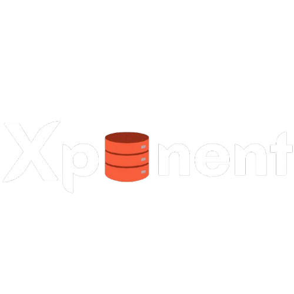
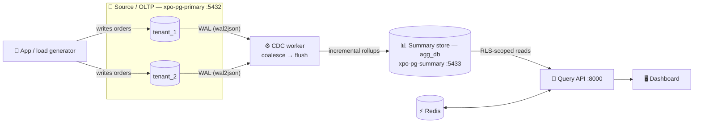

<div align="center">



# Xponent

### Multi-Tenant Live Aggregation Layer

**Fast, fresh, exact tenant dashboards over a busy OLTP database, without overloading it.**


[Quick start](#-quick-start) •
[Architecture](#-architecture) •
[Verify it yourself](#-verify-it-yourself) •
[API](#-api-reference) •
[Scale](#-scale) •
[Troubleshooting](#-troubleshooting)

</div>

---

## ✨ What is Xponent?

Each tenant (a restaurant, in the demo) has its **own source database**. Xponent
captures their changes with **Change-Data-Capture**, maintains **incremental rollups**
in a separate **summary store**, and serves dashboard queries from those rollups.

> 💡 Query cost depends on the **number of time-buckets**, not the number of rows.

| | Feature | What it means |
|:-:|---|---|
| ⚡ | **Fast** | Dashboard reads hit pre-aggregated buckets: sub-second, usually under 100 ms |
| 🔄 | **Fresh** | CDC streams new orders into the rollups within seconds |
| 🛡️ | **Safe for the source DB** | Dashboards never scan the OLTP tables |
| 🔒 | **Tenant-isolated** | Path identity + PostgreSQL Row-Level Security, zero cross-tenant leakage |
| 🎯 | **Correct** | Integer-cents math, exact for arbitrary (non-aligned) time ranges |
| 📈 | **Scales** | Designed and tested for 10M orders / 100 tenants |
| 🧾 | **Self-healing** | *Receipts*: per-bucket digests prove rollups match the source, with targeted repair |

---

## 🚀 Quick start

> **Judges: start here.**

**Prerequisites:** Docker (Compose v2) running, and Python 3.10+.

<details open>
<summary><b>🐧 macOS / Linux</b></summary>

```bash
python3 -m venv .venv && . .venv/bin/activate
pip install -r scripts/requirements.txt
./scripts/quickstart.sh
```

Bigger dataset:

```bash
ROWS=1000000 ./scripts/quickstart.sh
```

</details>

<details>
<summary><b>🪟 Windows (PowerShell)</b></summary>

```powershell
py -3.12 -m venv .venv
.\.venv\Scripts\pip.exe install -r scripts\requirements.txt
.\scripts\quickstart.ps1                                   # 50k orders across 5 tenants (skewed)
.\scripts\quickstart.ps1 -OrdersPerTenant 1000000          # exactly 1M orders for EVERY tenant (5M total)
.\scripts\quickstart.ps1 -OrdersPerTenant 1000000 -Tenants 10
```

</details>

The quickstart script does everything and prints each step:

1. 🐘 Starts the two PostgreSQL databases and Redis
2. 🏗️ Provisions the per-tenant source databases (`tenant_1`, `tenant_2`)
3. 🌱 Seeds synthetic orders (~200k per tenant by default)
4. 📊 Bootstraps the rollups and creates one CDC slot per tenant
5. ⚙️ Starts the CDC worker and the query API
6. ✅ Waits for health, then prints the URL

Then open **<http://localhost:8000>** and enter the operator key **`xpo-admin-dev`** in the sidebar (dev default).

### 🖥️ What you can do in the dashboard

| View | Who | Highlights |
|---|---|---|
| **Organization** | Platform owner | Platform-wide KPIs · restaurant **leaderboard** (click a row to open that restaurant) · **Ask across all restaurants** · **Live CDC activity** · **Databases** browser |
| **Restaurant** | Seller | Its own numbers only (server-enforced) · plain-English **Ask** box (instant) · **Orders** tab to create, edit, cancel and delete orders and watch the numbers update live |
| **Live load** | Anyone | `make load` streams **500 orders/sec** into the source DBs; watch the rollups keep up while freshness stays green |

---

## 🏛️ Architecture



### The two databases

This is the core of the design: **two separate databases**.

| | **Source / OLTP DB(s)** | **Summary / rollup store** |
|---|---|---|
| Container | `xpo-pg-primary` (`:5432`) | `xpo-pg-summary` (`:5433`) |
| Databases | `tenant_1`, `tenant_2` (one per tenant) | `agg_db` |
| Holds | Raw `orders`, `order_items`, `products`, `customers` | Pre-computed `agg_*` rollups + digests |
| Written by | The app / load generator | The **CDC worker** only |
| Read by the dashboard | **Never** (except tiny sub-minute edges) | **Always** |

### Key tables

**Source** (`tenant_N`)

- `orders(order_id, tenant_id, customer_id, status, total_amount_cents, created_at, …)`
- `order_items`, `products`, `customers`, `tenants`

**Summary** (`agg_db`)

- `agg_orders_daily` / `_hourly` / `_minutely` `(tenant_id, bucket, status, order_count, gross_sales_cents, net_sales_cents)`
- `agg_products_daily`
- `bucket_digests` (Receipts) · `cdc_checkpoint` (freshness) · `cdc_activity` (live feed)

---

## 🔍 Verify it yourself

### 1. Rollups are pre-computed (the fast path)

```bash
docker compose exec pg-summary psql -U agg_user -d agg_db \
  -c "SELECT tenant_id, day_bucket, status, order_count, gross_sales_cents
      FROM agg_orders_daily ORDER BY day_bucket DESC LIMIT 10;"
```

### 2. Dashboard numbers match the raw source (correctness)

Pick a day and compare. The two results should match **exactly**.

```bash
# Raw source table
docker compose exec pg-primary psql -U postgres -d tenant_1 \
  -c "SELECT count(*), sum(total_amount_cents) FROM orders
      WHERE created_at::date = '2026-07-02';"

# Rollup
docker compose exec pg-summary psql -U agg_user -d agg_db \
  -c "SELECT sum(order_count), sum(gross_sales_cents) FROM agg_orders_daily
      WHERE tenant_id=1 AND day_bucket='2026-07-02';"
```

### 3. Rollups update live (freshness)

In the **Orders** tab, create an order, then re-run your question in **Ask**. The
count goes up within seconds. Or watch **Organization → Live activity** show the CDC
events flowing in.

### 4. Receipts: the self-healing differentiator 🧾

Open **Diagnostics** (gear icon):

- **Verify** proves every `(tenant, day)` bucket's digest matches the source.
- **Repair day** re-derives one bucket while reading less than 1% of rows.

Or from the command line:

```bash
curl -s "http://localhost:8000/api/v1/admin/verification?tenant_id=1&run=true&sample=200" \
  -H "X-Admin-Key: xpo-admin-dev" | python3 -m json.tool
```

### 5. Automated checks (no DB needed)

```bash
python3 tests/correctness/test_receipts_core.py      # digest + targeted repair
python3 tests/correctness/test_range_decomposer.py   # exact non-aligned ranges
```

---

## 🗄️ Browse the data

Everything lives in PostgreSQL. You can browse it two ways.

**A) In the dashboard:** Organization view → **Databases**. Pick a database (any
tenant's source DB, or the summary store), pick a table, and see the real columns and
rows with an estimated row count.

**B) With `psql`:**

```bash
# Tenant 1's own source database: raw transactional rows
docker compose exec pg-primary psql -U postgres -d tenant_1 -c "\dt"          # list tables
docker compose exec pg-primary psql -U postgres -d tenant_1 -c "\d orders"    # columns of orders
docker compose exec pg-primary psql -U postgres -d tenant_1 -c "SELECT * FROM orders LIMIT 5;"

# Tenant 2 is a SEPARATE database on the same cluster
docker compose exec pg-primary psql -U postgres -d tenant_2 -c "SELECT count(*) FROM orders;"

# The summary store: pre-computed rollups the dashboard reads
docker compose exec pg-summary psql -U agg_user -d agg_db -c "\dt"
docker compose exec pg-summary psql -U agg_user -d agg_db -c "\d agg_orders_daily"
```

---

## 🔌 API reference

Seller endpoints are scoped by the `X-Dev-Tenant-ID` header, which must equal the path tenant.

| FR | Capability | Endpoint |
|----|---|---|
| FR-1 | Counts & totals | `GET /api/v1/tenants/{id}/orders/summary?from=&to=` |
| FR-2 | Trend over time | `GET /api/v1/tenants/{id}/orders/trends?from=&to=&granularity=day\|hour` |
| FR-3 | Top-N products | `GET /api/v1/tenants/{id}/products/top?from=&to=&limit=` |
| FR-4 | Status breakdown | `GET /api/v1/tenants/{id}/orders/by-status?from=&to=` |
| FR-5 | Tenant filter | Enforced on every call (path + RLS; cross-tenant → `403`) |
| FR-6 | Live updates | `POST/PATCH/DELETE /api/v1/tenants/{id}/orders…` → CDC → rollups |
| FR-7 | Simple API | This table + `GET /api/v1/health` |
| — | Natural language | `POST /api/v1/nlq` (plain English → validated plan → rollup read) |
| — | Organization | `GET /api/v1/org/overview`, `/org/activity` (operator key) |
| — | Explorer | `GET /api/v1/explore/databases`, `/explore/rows` (operator key) |

### 🎁 Bonus features

| ID | Feature | Where |
|---|---|---|
| B-1 | Freshness watermark on every response | All query endpoints |
| B-2 | Receipts verify + targeted repair | `/api/v1/admin/verification`, `/admin/rebuild` |
| B-3 | Per-tenant query rate limit | `429` past `TENANT_MAX_CONCURRENCY` |
| B-4 | Metrics defined in config, not code | [`app/metrics.json`](app/metrics.json) |
| B-5 | Pipeline monitoring | `/api/v1/status/pipeline` + the dashboard's **Data status** |

**Add a metric with no code change (B-4):** add an entry to `app/metrics.json`, and it
appears in the summary response and the dashboard's Quick insights.

```json
{ "name": "gross_per_order", "label": "Gross per order", "expr": "gross / orders", "format": "currency" }
```

---

## 🔥 Live load generator

Inserts are batched, not sent one row at a time.

```bash
make load                         # 500 orders/sec for 60s into the source DBs
RATE=1000 DURATION=120 make load  # custom rate and duration
```

Each inserted order flows through CDC into the rollups. Watch **Organization → Live
activity** and the KPIs climb while **Data status** stays *Up to date*.

---

## 📈 Scale

The quickstart seeds a small dataset so you're running in under a minute. The design
targets the PRD's main run, **10M orders / 100 tenants**. Because query cost depends on
the number of time-buckets rather than rows, dashboards stay sub-second as data grows.

```bash
make seed-bench     # 10M orders / 100 tenants on the shared-DB topology (takes minutes)
```

For sustained growth during judging, leave `make load` running. It adds hundreds of
orders per second indefinitely.

<details>
<summary><b>🛠️ Other Makefile targets</b></summary>

| Target | Purpose |
|---|---|
| `make up` / `make down` | Start / stop the stack |
| `make clean` | Stop and remove volumes |
| `make ps` / `make logs` | Container status / logs |
| `make psql-primary` / `make psql-summary` | Open a `psql` shell on either database |
| `make seed-dev` / `make seed-demo` / `make seed-bench` | Seed small / demo / benchmark datasets |
| `make verify-caps` | Check container CPU and memory limits |
| `make help` | List all targets |

</details>

---

## 📁 Project structure

```text
Xponent/
├── app/            # FastAPI query API: routers, services (NLQ, receipts, range decomposer)
├── worker/         # CDC worker: bootstrap, event processing, coalescer, flusher
├── common/         # Shared rollup, hashing and tenant-registry code
├── db/
│   ├── primary/    # Source DB schema, roles, publication (PostgreSQL 16 + wal2json)
│   └── summary/    # Summary store schema, indexes, roles, RLS policies
├── frontend/       # Dashboard (HTML / CSS / JS)
├── scripts/        # Quickstart, seeding, load generator, fault injection
├── tests/          # Correctness tests
└── docs/           # PRD compliance, implementation plan, decisions, runbook
```

---

## 🧭 Design decisions & docs

**In brief:**

- PostgreSQL only; Python end to end
- CDC (wal2json) → incremental Z-set rollups
- Non-aligned ranges answered from day / hour / minute buckets, never from the source
- Tenant isolation via path + RLS
- No JWT (the PRD excludes auth)

**Further reading:**

| Document | Contents |
|---|---|
| [`docs/PRD_COMPLIANCE.md`](docs/PRD_COMPLIANCE.md) | Every goal, FR, bonus and target mapped to code, with how to verify |
| [`docs/DEMO_RUNBOOK.md`](docs/DEMO_RUNBOOK.md) | Step-by-step demo script |
| [`docs/IMPLEMENTATION_PLAN.md`](docs/IMPLEMENTATION_PLAN.md) | Build plan |
| [`docs/TECHNICAL_GAP_ANALYSIS.md`](docs/TECHNICAL_GAP_ANALYSIS.md) | Gap analysis |
| [`docs/OPEN_DECISIONS.md`](docs/OPEN_DECISIONS.md) | Design decisions log |
| [`docs/PROGRESS.md`](docs/PROGRESS.md) | Progress tracker |

---

## 🩺 Troubleshooting

| Symptom | Fix |
|---|---|
| Org view empty / `403` | Enter the operator key `xpo-admin-dev` in the sidebar |
| `psycopg` missing | `pip install -r scripts/requirements.txt` inside your venv |
| **Ask** is slow | The first LLM call can be slow; recognised questions use the instant rules path. Set `NLQ_PROVIDER=rules` to always use it |
| Need a clean slate | `docker compose down -v && ./scripts/quickstart.sh` |

<div align="center">

---

Built with ☕ for the hackathon.

</div>
